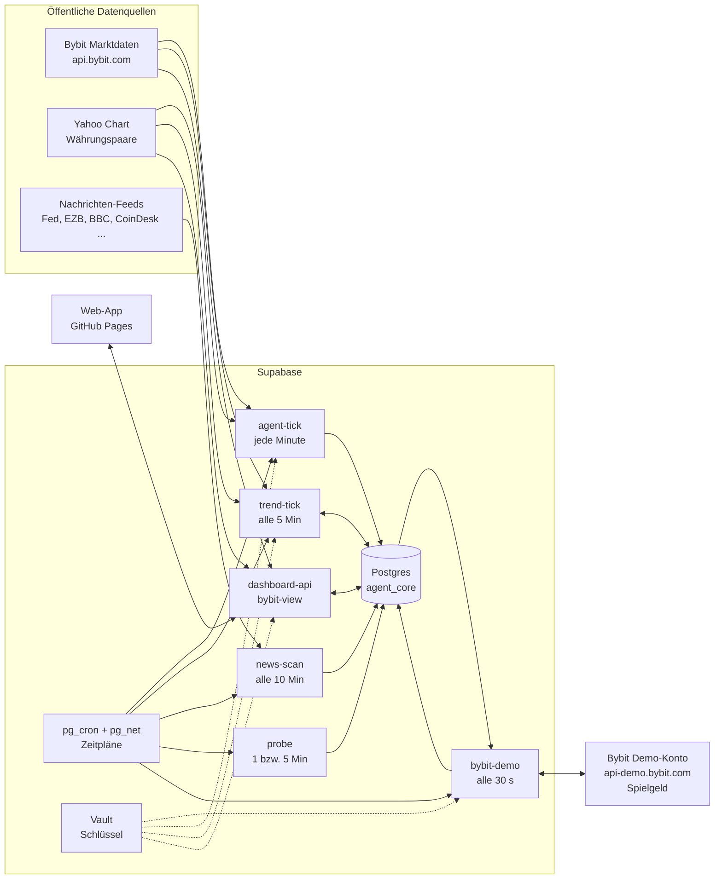

# Architektur

Alles läuft auf kostenlosen Diensten: Supabase (Datenbank, Edge Functions, Zeitpläne, Vault) und GitHub Pages (Web-App). Es gibt keinen eigenen Server.

## Motoren

Jeder Agent hat in `config.engine` seinen Motor. Ohne Angabe gilt `minute`.

| Motor | Funktion | Konten | Entscheidung |
|---|---|---|---|
| `trend` | trend-tick | Beta (Momentum-Abstimmung, Krypto), Gamma (Turtle 55/20, Krypto), Delta (Momentum-Abstimmung, 6 Währungspaare, beide Richtungen) | einmal je abgeschlossener Tageskerze, Regeln aus dem Regelbuch, siehe [REGELBUCH.md](REGELBUCH.md) |
| `manual` | dashboard-api | „Ich · Selbst gehandelt“, das Übungskonto des Nutzers | der Nutzer selbst im Bereich „Selbst handeln“ der App |
| `minute` | agent-tick | Alpha, seit 3. November im Ruhestand (`strategy.retired`) | jede Minute, Signalqualität 0 bis 100 |

agent-tick sammelt jede Minute die Kerzen der Märkte von Minuten-Agenten (BTC, ETH, SOL, EUR/USD über Alpha) und bewertet sie für die Marktübersicht der App. Für Trend- und Handkonten sammelt es seit dem 4. November nichts mehr, damit die Datenbank nicht um etwa 50 MB im Monat wächst. Deren Preise stehen in `agent_core.quotes`: trend-tick aktualisiert sie alle 5 Minuten für offene Positionen, dashboard-api bei jedem Abruf im Bereich „Selbst handeln“. Die App nimmt je Markt den neuesten Preis aus Minutenkerzen oder `quotes`.

## Ablauf eines Trades (Trend-Agent)

1. **trend-tick** holt alle 5 Minuten die Tageskerzen (Krypto von Bybit, Währungspaare von Yahoo). Ist seit der letzten Entscheidung eine neue Kerze abgeschlossen, fragt er die Regel (`engine.ts`, dieselbe Logik wie die Simulation in `lab.ts`).
2. Vor einem Kauf prüft er: Notbremse, Agent aktiv, Markt eingeschaltet, Rückgangs-Limit, Nachrichten-Pause, Termin-Sperre. Die Größe richtet sich nach der Schwankung des Marktes und wird an Tagen mit vielen wichtigen Nachrichten halbiert.
3. Die Papier-Position wird in `agent_core.positions` gespeichert, inklusive Gebühren und Schlupf. Kursziel gibt es keins; einen Stop nur bei Regeln mit Trailing-Stop. Bei Währungen (Delta) ist auch eine Short-Position möglich: Verkauf zum Geldkurs, Rückkauf zum Briefkurs, der Einsatz wird wie bei einem Kauf als Sicherheit zurückgelegt (kein Hebel). Ist der Devisenmarkt zu (Kurs älter als 20 Minuten), wartet die Entscheidung; Ausstiege beliebig lange, Einstiege höchstens 72 Stunden.
4. **bybit-demo** findet die neue Krypto-Long-Position beim nächsten Lauf, kauft dieselbe Menge auf dem Demo-Konto (Market-Order, Spot) und schreibt die Ausführung nach `agent_core.exchange_orders`.
5. Schaltet die Regel aus (oder greift der Trailing-Stop), verkauft trend-tick die Papier-Position und bybit-demo verkauft auf dem Demo-Konto.
6. Nach jedem geschlossenen Trade aktualisiert `fn_after_close` die Lernstatistik des Setups. Setups mit klar negativem Erwartungswert werden für 24 Stunden gesperrt.
7. `fn_check_replication` schlägt bei mindestens 500 € realisiertem Tagesgewinn einen neuen Agenten vor (mit Freigabe, höchstens `max_agents`).

## Ablauf eines eigenen Trades (Selbst handeln)

1. Die App fragt dashboard-api mit `manual_quote` nach Kursen (alle 7 Märkte, höchstens alle 25 Sekunden; für den gewählten Markt zusätzlich der Verlauf der letzten 48 Stunden).
2. Nach Bestätigung schickt sie `manual_open` mit Markt, Richtung und Betrag in Rubel. dashboard-api holt den Kurs neu, prüft Notbremse, Markt, Mindestbetrag, freies Kapital und dass der Markt offen ist, sperrt die Kontozeile und bucht die Papier-Position zum Briefkurs (Kauf) bzw. Geldkurs (Verkauf) plus Schlupf und Gebühr. Rechenregeln in `dashboard-api/manual.ts`, ein Test prüft, dass sie dieselben Zahlen liefern wie der Trend-Motor.
3. `manual_close` schließt eine eigene Position zum aktuellen Kurs, mit derselben Buchhaltung wie bei den Agenten.
4. Krypto-Käufe des Handkontos spiegelt bybit-demo wie die der Agenten auf das Demo-Konto.

## Edge Functions

| Funktion | Version in Supabase | Aufgabe | Auslöser |
|---|---|---|---|
| agent-tick | 4 | Kerzen sammeln (nur Märkte von Minuten-Agenten), Märkte bewerten; Minuten-Agenten: Papier-Trades, Risiko, Lernen, Vermehrung | Zeitplan, jede Minute |
| trend-tick | 3 | Trend-Agenten: Tagesregel für Krypto (nur Kauf) und Währungen (beide Richtungen), Schutzschicht je Marktklasse, Mindestorder, Papier-Trades, Rückgangs-Limit, Vermehrung; Rubelkurs stündlich; Preise für `quotes`; stündlicher Kapitalstand des Handkontos | Zeitplan, alle 5 Min |
| bybit-demo | 6 | Spiegeln auf Bybit-Demo, Kontostand, Selbsttest | Zeitplan, alle 30 s |
| news-scan | 1 | Nachrichten lesen und bewerten | Zeitplan, alle 10 Min |
| probe | 3 | Datenquellen prüfen (alte Tabelle `trading_sim`) | Zeitplan, 1 bzw. 5 Min |
| dashboard-api | 9 | Daten und Steuerung für die App, zählt nur ab `stats_since`; eigene Papier-Trades (`manual_quote`, `manual_open`, `manual_close`); Kerzen für den Live-Chart (`manual_chart`) | App |
| bybit-view | 4 | Daten und Schalter für den Bereich Bybit-Demo, zählt nur ab `stats_since` | App |
| backtest | 1 | Strategie auf gespeicherter 1-Min-Historie nachspielen | auf Abruf |
| strategy-lab | 5 | Bekannte Strategien, Regelbuch und Mehrmarkt-Studie (Krypto, Rohstoffe, Währungen; kurze und lange Varianten) testen | auf Abruf |

Alle Funktionen haben `verify_jwt = false` und prüfen selbst: die Zeitplan-Funktionen den Header `x-agent-secret`, die App-Funktionen den Header `x-dashboard-token`. Ausnahme: dashboard-api nimmt `x-agent-secret` auch an, aber nur für die zwei reinen Marktdaten-Aktionen `manual_quote` und `manual_chart` (für Prüfungen aus der Datenbank per pg_net); alles andere antwortet dann mit 403.

## Live-Chart in der App

Der Kerzen-Chart im Bereich „Selbst handeln“ ist selbst gezeichnet (Canvas, keine fremde Bibliothek, nichts wird von anderen Servern nachgeladen).

1. Verlauf: die App fragt `manual_chart` mit Markt und Zeiteinheit (1m, 5m, 15m, 1h, 4h, 1D) und bekommt bis zu 400 Kerzen. Krypto von Bybit (`/v5/market/kline`), Währungen von Yahoo (4-Stunden-Kerzen aus Stundenkerzen zusammengesetzt).
2. Live, Krypto: der Browser verbindet sich direkt mit dem öffentlichen Bybit-Datenstrom `wss://stream.bybit.com/v5/public/spot` (Themen `kline.<Zeiteinheit>.<Symbol>` und `tickers.<Symbol>`, Ping alle 20 s). Kommt nach drei Versuchen keine Verbindung zustande, fragt die App stattdessen alle 5 Sekunden `manual_chart` mit `limit: 3`.
3. Live, Währungen: kein Datenstrom; die App fragt alle 20 Sekunden die letzten Kerzen. Yahoo liefert bis etwa 1 Minute verzögert.
4. Die Verbindung wird beendet, sobald der Bereich verlassen oder das Handy gesperrt wird, und beim Zurückkommen neu aufgebaut (Verlauf wird neu geladen).
5. Gestrichelte Linien zeigen die Einstiegskurse offener Positionen in diesem Markt: eigene farbig, die der Agenten grau.

## Zeitpläne (pg_cron)

| Name | Takt | Ruft auf |
|---|---|---|
| agent_tick | `* * * * *` | agent-tick |
| trend_tick | `2-59/5 * * * *` | trend-tick |
| bybit_reconcile | `30 seconds` | bybit-demo `{"action":"reconcile"}` |
| news_scan | `*/10 * * * *` | news-scan |
| probe_crypto | `* * * * *` | probe `{"group":"crypto"}` |
| probe_others | `*/5 * * * *` | probe `{"group":"others"}` |
| retention_source_checks | `17 3 * * *` | löscht Probe-Protokolle älter als 3 Tage |

## Tabellen (Schema `agent_core`)

| Tabelle | Inhalt |
|---|---|
| settings | eine Zeile: Notbremse, `paper_only` (immer true), Märkte, Vermehrungsregeln, EUR/USD- und USD/RUB-Kurs, Beginn der Statistik (`stats_since`) |
| agents | Agenten mit Konfiguration, Status, Kapital |
| positions | Papier-Trades, offen und geschlossen, mit Gebühren und Ergebnis |
| signals | Entscheidungen pro Markt (Minuten-Agent jede Minute, Trend-Agent je Tageskerze) |
| equity_snapshots | Kapitalverlauf pro Agent |
| lessons | Lernstatistik pro Setup (Markt, Richtung, Tageszeit) |
| candles, data_status | Kerzen und Zustand der Datenquellen |
| quotes | neuester Preis je Markt für Positionen ohne Minutenkerzen (Währungspaare, XAUT), mit Zeitpunkt an der Quelle |
| news_items, news_sources | Schlagzeilen und Zustand der Feeds |
| event_calendar | feste Termine mit hoher Wirkung (z. B. US-Zinsentscheid), sperren neue Käufe der Trend-Agenten |
| notifications | Meldungen für die App |
| replication_events | Vermehrungs-Vorschläge |
| exchange_config | eine Zeile: Spiegeln an/aus, letzter Lauf, letzter Fehler |
| exchange_orders | jede Bybit-Demo-Order mit Ausführung, Gebühren, Preisabweichung |
| exchange_wallet_snapshots | Kontostand des Demo-Kontos, höchstens alle 4 Minuten |
| hist_candles, hist_bars, bt_trades, lab_runs | Forschung: Historie und Backtest-Ergebnisse |

Alle Tabellen haben Row Level Security ohne Richtlinien und keine Rechte für `anon` und `authenticated`. Nur die Edge Functions (Service-Rolle) lesen und schreiben.

Das ältere Schema `trading_sim` stammt aus der ersten Phase und wird nur noch von `probe` beschrieben.
