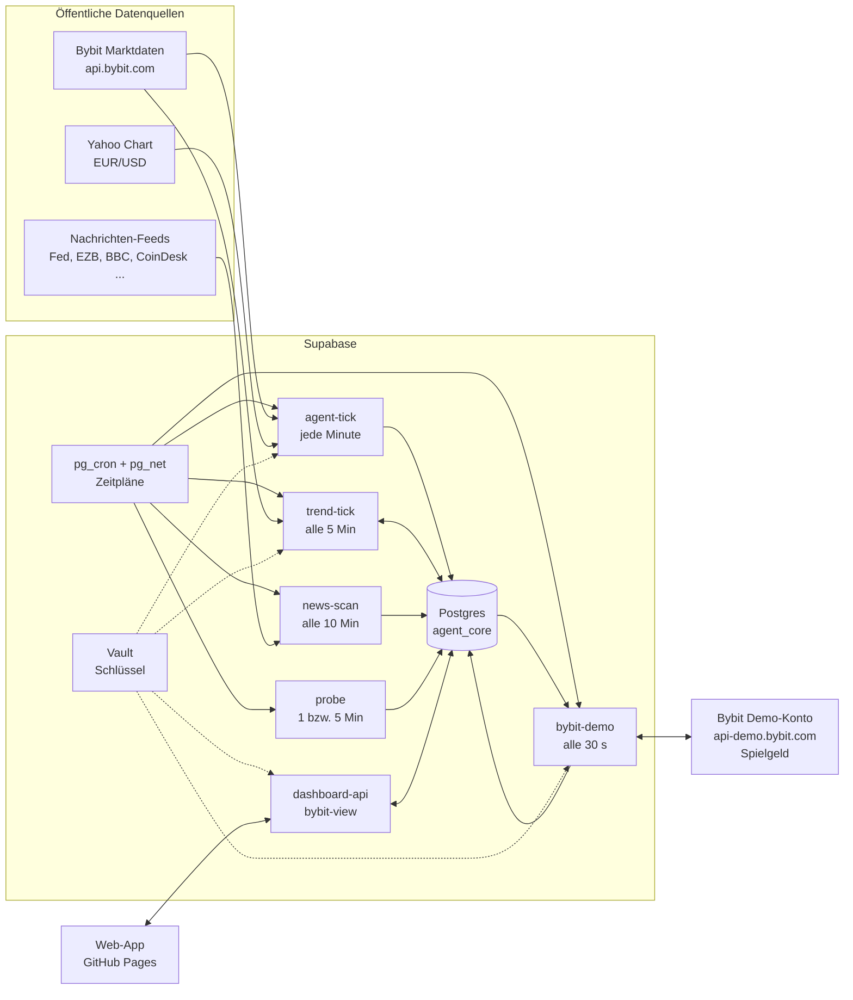

# Architektur

Alles läuft auf kostenlosen Diensten: Supabase (Datenbank, Edge Functions, Zeitpläne, Vault) und GitHub Pages (Web-App). Es gibt keinen eigenen Server.

## Zwei Motoren

Jeder Agent hat in `config.engine` seinen Motor. Ohne Angabe gilt `minute`.

| Motor | Funktion | Agenten | Entscheidung |
|---|---|---|---|
| `trend` | trend-tick | Beta (Momentum-Abstimmung), Gamma (Turtle 55/20) | einmal je abgeschlossener Tageskerze, Regeln aus dem Regelbuch, siehe [REGELBUCH.md](REGELBUCH.md) |
| `minute` | agent-tick | Alpha, seit 3. November im Ruhestand (`strategy.retired`) | jede Minute, Signalqualität 0 bis 100 |

agent-tick sammelt weiter jede Minute die Kerzen aller Märkte und bewertet sie für die Marktübersicht der App, auch wenn kein Minuten-Agent mehr handelt.

## Ablauf eines Trades (Trend-Agent)

1. **trend-tick** holt alle 5 Minuten die Tageskerzen von Bybit. Ist seit der letzten Entscheidung eine neue Kerze abgeschlossen, fragt er die Regel (`engine.ts`, dieselbe Logik wie die Simulation in `lab.ts`).
2. Vor einem Kauf prüft er: Notbremse, Agent aktiv, Markt eingeschaltet, Rückgangs-Limit, Nachrichten-Pause, Termin-Sperre. Die Größe richtet sich nach der Schwankung des Marktes und wird an Tagen mit vielen wichtigen Nachrichten halbiert.
3. Die Papier-Position wird in `agent_core.positions` gespeichert, inklusive Gebühren und Schlupf. Kursziel gibt es keins; einen Stop nur bei Regeln mit Trailing-Stop.
4. **bybit-demo** findet die neue Krypto-Long-Position beim nächsten Lauf, kauft dieselbe Menge auf dem Demo-Konto (Market-Order, Spot) und schreibt die Ausführung nach `agent_core.exchange_orders`.
5. Schaltet die Regel aus (oder greift der Trailing-Stop), verkauft trend-tick die Papier-Position und bybit-demo verkauft auf dem Demo-Konto.
6. Nach jedem geschlossenen Trade aktualisiert `fn_after_close` die Lernstatistik des Setups. Setups mit klar negativem Erwartungswert werden für 24 Stunden gesperrt.
7. `fn_check_replication` schlägt bei mindestens 500 € realisiertem Tagesgewinn einen neuen Agenten vor (mit Freigabe, höchstens `max_agents`).

## Edge Functions

| Funktion | Version in Supabase | Aufgabe | Auslöser |
|---|---|---|---|
| agent-tick | 3 | Kerzen sammeln, Märkte bewerten; Minuten-Agenten: Papier-Trades, Risiko, Lernen, Vermehrung | Zeitplan, jede Minute |
| trend-tick | 1 | Trend-Agenten: Tagesregel, Schutzschicht, Papier-Trades, Rückgangs-Limit, Vermehrung | Zeitplan, alle 5 Min |
| bybit-demo | 6 | Spiegeln auf Bybit-Demo, Kontostand, Selbsttest | Zeitplan, alle 30 s |
| news-scan | 1 | Nachrichten lesen und bewerten | Zeitplan, alle 10 Min |
| probe | 3 | Datenquellen prüfen (alte Tabelle `trading_sim`) | Zeitplan, 1 bzw. 5 Min |
| dashboard-api | 6 | Daten und Steuerung für die App | App |
| bybit-view | 3 | Daten und Schalter für den Bereich Bybit-Demo | App |
| backtest | 1 | Strategie auf gespeicherter 1-Min-Historie nachspielen | auf Abruf |
| strategy-lab | 3 | Bekannte Strategien und das Regelbuch (Portfolio, 4h und Tag) testen | auf Abruf |

Alle Funktionen haben `verify_jwt = false` und prüfen selbst: die Zeitplan-Funktionen den Header `x-agent-secret`, die App-Funktionen den Header `x-dashboard-token`.

## Zeitpläne (pg_cron)

| Name | Takt | Ruft auf |
|---|---|---|
| agent_tick | `* * * * *` | agent-tick |
| trend_tick | `2-59/5 * * * *` | trend-tick |
| bybit_reconcile | `30 seconds` | bybit-demo `{"action":"reconcile"}` |
| news_scan | `*/10 * * * *` | news-scan |
| probe_crypto | `* * * * *` | probe `{"group":"crypto"}` |
| probe_others | `*/5 * * * *` | probe `{"group":"others"}` |
| retention_source_checks | `17 3 * * *` | löscht Probe-Protokolle älter als 3 Tage |

## Tabellen (Schema `agent_core`)

| Tabelle | Inhalt |
|---|---|
| settings | eine Zeile: Notbremse, `paper_only` (immer true), Märkte, Vermehrungsregeln, EUR/USD-Kurs |
| agents | Agenten mit Konfiguration, Status, Kapital |
| positions | Papier-Trades, offen und geschlossen, mit Gebühren und Ergebnis |
| signals | Entscheidungen pro Markt (Minuten-Agent jede Minute, Trend-Agent je Tageskerze) |
| equity_snapshots | Kapitalverlauf pro Agent |
| lessons | Lernstatistik pro Setup (Markt, Richtung, Tageszeit) |
| candles, data_status | Kerzen und Zustand der Datenquellen |
| news_items, news_sources | Schlagzeilen und Zustand der Feeds |
| event_calendar | feste Termine mit hoher Wirkung (z. B. US-Zinsentscheid), sperren neue Käufe der Trend-Agenten |
| notifications | Meldungen für die App |
| replication_events | Vermehrungs-Vorschläge |
| exchange_config | eine Zeile: Spiegeln an/aus, letzter Lauf, letzter Fehler |
| exchange_orders | jede Bybit-Demo-Order mit Ausführung, Gebühren, Preisabweichung |
| exchange_wallet_snapshots | Kontostand des Demo-Kontos, höchstens alle 4 Minuten |
| hist_candles, hist_bars, bt_trades, lab_runs | Forschung: Historie und Backtest-Ergebnisse |

Alle Tabellen haben Row Level Security ohne Richtlinien und keine Rechte für `anon` und `authenticated`. Nur die Edge Functions (Service-Rolle) lesen und schreiben.

Das ältere Schema `trading_sim` stammt aus der ersten Phase und wird nur noch von `probe` beschrieben.
